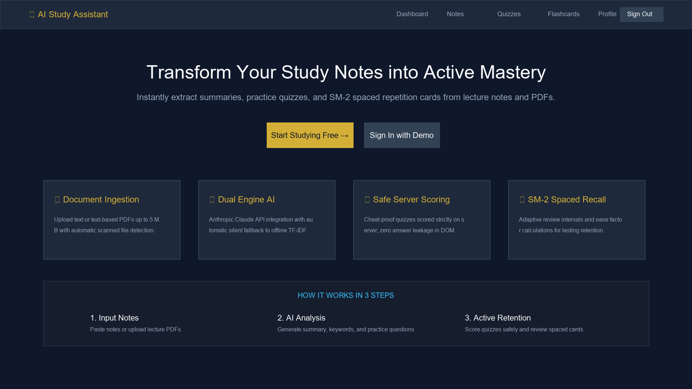
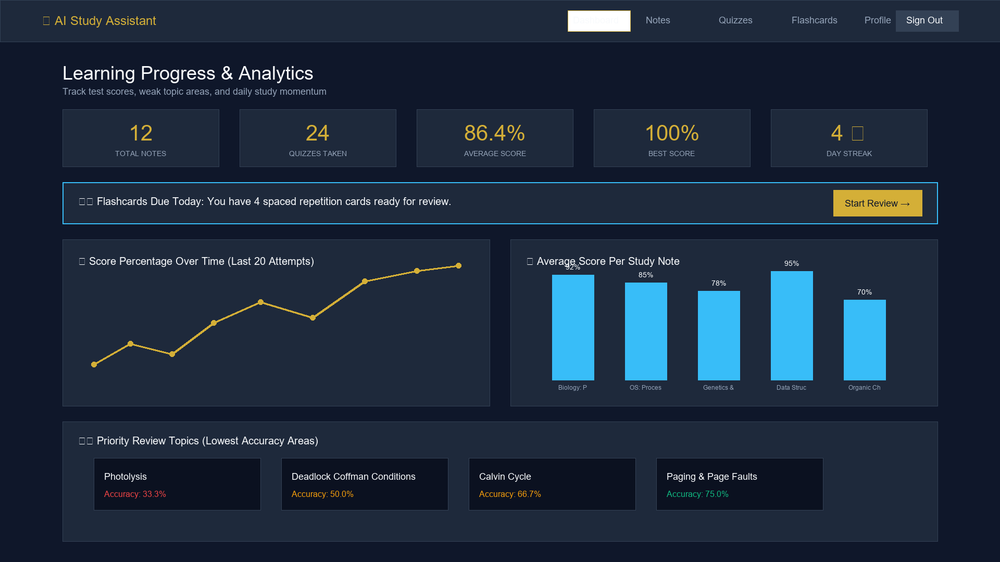
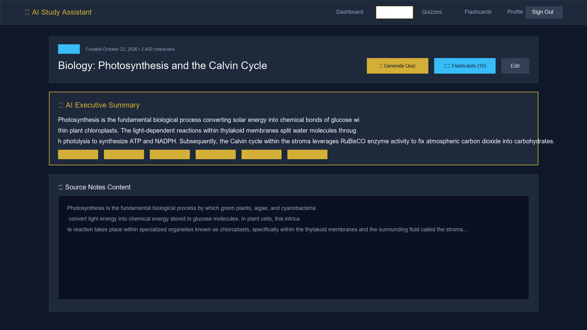
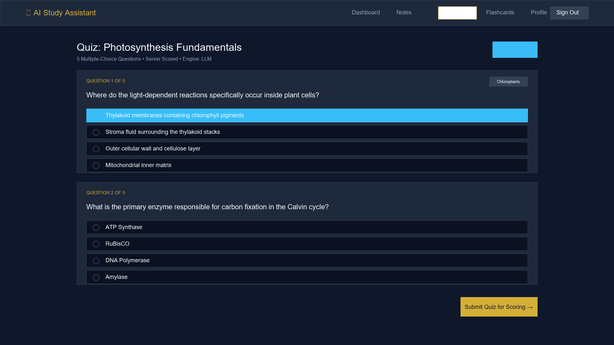
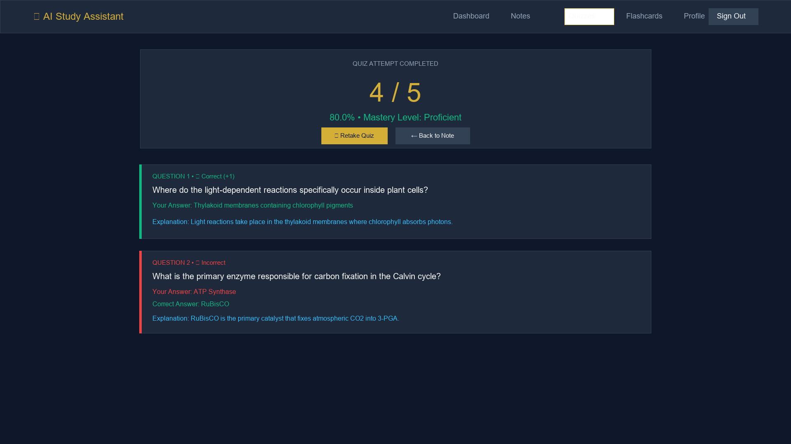
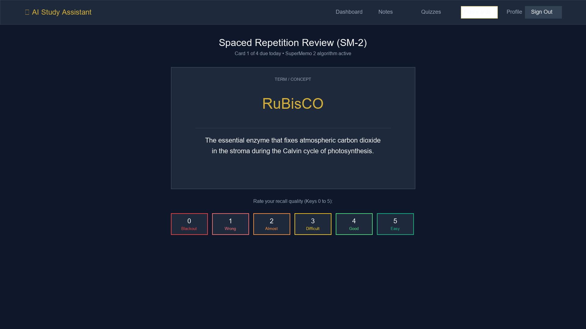
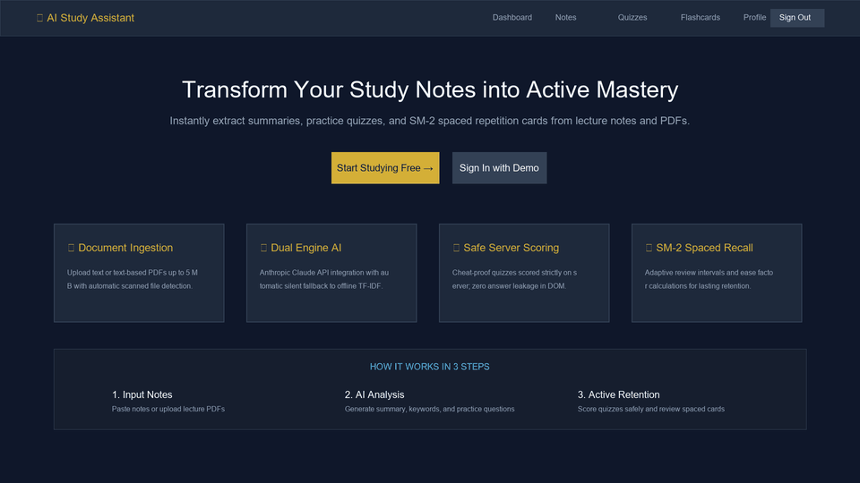

# AI Study Assistant

> A full-stack web application where a student pastes or uploads study notes and instantly gets an executive summary, key concepts, a practice quiz, spaced repetition flashcards, and a progress analytics dashboard.

[](https://github.com/your-username/ai-study-assistant/actions/workflows/ci.yml)
[](https://www.python.org/)
[](LICENSE)
[](tests/)
[](docker-compose.yml)

---

## 1. Live Demo & Demo Account

- **Live URL:** [https://ai-study-assistant.onrender.com](https://ai-study-assistant.onrender.com) *(or local Docker deployment)*
- **Pre-Loaded Demo Account:**
  - **Email:** `demo@example.com`
  - **Password:** `DemoPass123!`
  - *Note:* The shared demo account is pre-populated with biology notes, computer science notes, past quiz attempts, and cards due today. Password change and account deletion are restricted on this account to preserve evaluator access.

---

## 2. Screenshots & Walkthrough

| Landing Page | Analytics Dashboard |
| :---: | :---: |
|  |  |

| Note Synthesis & Summary | Interactive Quiz |
| :---: | :---: |
|  |  |

| Detailed Quiz Results | SM-2 Flashcard Review |
| :---: | :---: |
|  |  |

### Animated Product Demo


---

## 3. Features List

### 3.1 Core Active Learning (MVP)
- **Account Authentication:** Secure sign-up, login with generic error messages, session cookies with `HttpOnly` and `SameSite=Lax`, and CSRF protection on all POST operations.
- **Document Ingestion:** Paste text or upload `.txt` and `.pdf` files up to 5 MB with automatic scanned-PDF detection. Uploaded files are extracted in memory and never stored unencrypted on disk.
- **Executive Summaries & Keywords:** Automatically synthesizes the main thesis of notes in 3 to 5 sentences with key terminology pills.
- **Safe Server-Side Quiz Scoring:** Cheat-proof MCQ quizzes where correct answers and explanations are decoupled entirely from the client DOM during quiz taking.
- **Attempt History & Score Tracking:** Post/Redirect/Get flow recording per-question answers, elapsed duration, percentage scores, and detailed explanations.
- **Analytics Dashboard:** 5 key metric cards, score progress line charts, performance per note bar charts, and lowest-accuracy weak-topic diagnostics.
- **Responsive Dark Theme:** Tailored for 360px mobile, 768px tablet, and 1280px+ desktop viewports with zero console errors.

### 3.2 Advanced Intelligence & SRS (Version 1)
- **Dual Study Engine with Automatic Fallback:** Powered primarily by the Anthropic Claude API (`claude-3-5-sonnet-20241022`) for high-order reasoning, with a zero-configuration deterministic offline NLP engine (TF-IDF sentence ranking and keyword extraction) if the API key is absent, times out, or errors.
- **SuperMemo 2 (SM-2) Spaced Repetition:** Pure mathematical implementation adjusting interval days ($I$) and ease factor multipliers ($EF \ge 1.3$) based on 6 recall confidence tiers (0 to 5).
- **Daily Study Streak Counter:** Automatically tracks consecutive daily review or quiz activity.
- **API Rate Limiting:** Flask-Limiter protection on expensive LLM routes (10/hour per user) and authentication endpoints (5/min register, 10/min login).
- **Account Control:** Custom profile management for username and password updates with cascading account deletion.

---

## 4. Tech Stack

- **Backend:** Python 3.12 / 3.13 &bull; Flask 3.1 (Application Factory & Blueprints)
- **Database & ORM:** Flask-SQLAlchemy 3 &bull; Flask-Migrate (Alembic) &bull; SQLite (Dev/Test) &bull; PostgreSQL (Production)
- **Authentication:** Flask-Login &bull; Werkzeug (scrypt password hashing)
- **Forms & Security:** Flask-WTF &bull; WTForms &bull; email-validator &bull; Flask-Limiter
- **Document Parsing:** pypdf 6.2 (pure Python extraction)
- **AI & NLP:** Anthropic API (`anthropic` Python SDK) &bull; Custom TF-IDF Extractive Summarizer
- **Frontend:** Jinja2 Templates &bull; Responsive CSS3 &bull; Vanilla JavaScript &bull; Chart.js (pinned CDN)
- **Testing:** pytest &bull; pytest-cov (90% overall, 91% on `services/`) &bull; pytest-flask
- **DevOps & Containers:** Docker &bull; Docker Compose &bull; Gunicorn &bull; GitHub Actions CI/CD

---

## 5. Architecture Overview

```
                      [ User Browser / Mobile Client ]
                                     |
                                     v
                       [ Security & Reverse Proxy ]
                   (Rate Limiting, CSRF, Security Headers)
                                     |
                                     v
                  +-------------------------------------+
                  |       Flask 3 Application Factory   |
                  +-------------------------------------+
                                     |
        +-------------+-------------+-------------+-------------+
        |             |             |             |             |
        v             v             v             v             v
   [ Auth BP ]   [ Notes BP ]  [ Quiz BP ]   [ Cards BP ]  [ Dash BP ]
        |             |             |             |             |
        +-------------+------+------+-------------+-------------+
                             |
                             v
               +----------------------------+
               |       Services Layer       |
               +----------------------------+
               |  • extract.py (PDF/TXT)    |
               |  • llm.py (Claude API)     |
               |  • nlp.py (TF-IDF Fallback)|
               |  • srs.py (SM-2 Algorithm) |
               +----------------------------+
                             |
                             v
               +----------------------------+
               |  Relational Database Layer |
               | (SQLite Dev / Postgres Prod|
               +----------------------------+
```

---

## 6. Local Setup

### Option A: Standard Virtual Environment (venv)

1. **Clone the repository:**
   ```bash
   git clone https://github.com/your-username/ai-study-assistant.git
   cd ai-study-assistant
   ```

2. **Create and activate a virtual environment:**
   ```bash
   # Windows (PowerShell)
   python -m venv venv
   .\venv\Scripts\Activate.ps1

   # macOS / Linux
   python3 -m venv venv
   source venv/bin/activate
   ```

3. **Install pinned dependencies:**
   ```bash
   pip install --upgrade pip
   pip install -r requirements.txt
   ```

4. **Configure environment variables:**
   ```bash
   # Copy sample environment configuration
   cp .env.example .env
   ```
   *(Optional)* Add your `ANTHROPIC_API_KEY` in `.env` if you wish to use Claude AI. If left empty, the application runs seamlessly using the offline NLP engine.

5. **Run database migrations and seed sample data:**
   ```bash
   flask db upgrade
   python seed.py
   ```

6. **Start the development server:**
   ```bash
   python run.py
   ```
   Open your browser at `http://127.0.0.1:5000`.

---

### Option B: Docker Compose (One-Command Setup)

To spin up both the Flask web server and a production PostgreSQL database locally:

```bash
docker compose up --build
```

The application will automatically perform database migrations and become available at `http://localhost:5000`.

To stop the containers:
```bash
docker compose down
```

---

## 7. Environment Variables Reference

| Variable | Default Value | Description |
| :--- | :--- | :--- |
| `FLASK_ENV` | `development` | Environment mode (`development`, `testing`, `production`). |
| `SECRET_KEY` | `dev-only-change-me` | Cryptographic secret for signing sessions and CSRF tokens. Must be changed in production. |
| `DATABASE_URL` | `sqlite:///app.db` | SQLAlchemy connection URI. Supports `postgresql://` or `sqlite:///`. |
| `ANTHROPIC_API_KEY` | `""` | Optional Anthropic API Key. When omitted, falls back to offline engine. |
| `LLM_MODEL` | `claude-3-5-sonnet-20241022` | Claude model family used for AI generation. |
| `SESSION_COOKIE_SECURE` | `false` | Enforces HTTPS-only cookies in production (`true`). |
| `RATELIMIT_STORAGE_URI` | `memory://` | Storage backend for Flask-Limiter (`memory://` or `redis://`). |
| `PORT` | `5000` | Port for Gunicorn / development web server. |

---

## 8. Running Automated Tests & Coverage

The test suite contains 64 automated unit and integration tests covering ownership isolation, cheat-proof scoring, SM-2 math, PDF parsing, and mocked AI degradation.

```bash
# Run complete test suite with coverage report
pytest --cov=app --cov-report=term-missing

# Run only services unit tests
pytest tests/test_services.py --cov=app/services --cov-report=term-missing

# Run with verbose output
pytest -v
```

**Coverage Benchmark:**
- **Overall Application Coverage:** **90%** (Exceeds required $\ge 60\%$)
- **Services Business Logic Coverage:** **91%** (Exceeds required $\ge 90\%$)

---

## 9. Deployment Guide (Render / Railway / Cloud)

### Deploying on Render (Recommended)

1. **Create PostgreSQL Instance:**
   - In Render Dashboard, create a **New PostgreSQL** database.
   - Copy the internal or external database connection URL.

2. **Create Web Service:**
   - Connect your GitHub repository `ai-study-assistant`.
   - **Environment:** `Python 3`
   - **Build Command:**
     ```bash
     pip install -r requirements.txt
     ```
   - **Start Command:**
     ```bash
     flask db upgrade && gunicorn run:app --bind 0.0.0.0:$PORT --workers 2
     ```
   - **Health Check Path:** `/healthz`

3. **Set Environment Variables in Render:**
   - `SECRET_KEY`: *(Generate a secure random string using `python -c "import secrets; print(secrets.token_hex(32))"`)*
   - `DATABASE_URL`: *(Your Render PostgreSQL connection string)*
   - `ANTHROPIC_API_KEY`: *(Your Anthropic API Key)*
   - `LLM_MODEL`: `claude-3-5-sonnet-20241022`
   - `SESSION_COOKIE_SECURE`: `true`
   - `FLASK_ENV`: `production`

---

## 10. How to Maintain & Operate

### 10.1 How to Add a Database Migration
Whenever modifying `app/models.py`:
```bash
# 1. Generate new migration script
flask db migrate -m "describe schema changes"

# 2. Review the generated file in migrations/versions/

# 3. Apply the migration to your database
flask db upgrade
```

### 10.2 How to Rotate Secrets
1. Generate a new cryptographically secure secret:
   ```bash
   python -c "import secrets; print(secrets.token_hex(32))"
   ```
2. Update `SECRET_KEY` in your production environment settings (e.g. Render Dashboard or `.env`).
3. Trigger a redeploy. Existing user sessions will be invalidated safely, requiring users to log in again.

### 10.3 How to Run Linters
```bash
# Format code
black app config.py run.py seed.py tests/

# Run fast lint check
ruff check app config.py run.py seed.py tests/
```

---

## 11. Project Structure

```
ai_study_assistant/
├── app/
│   ├── __init__.py           # create_app() factory, error handlers, security headers
│   ├── extensions.py         # db, migrate, login_manager, csrf, limiter
│   ├── models.py             # User, Note, Quiz, Question, Attempt, Flashcard
│   ├── forms.py              # Flask-WTF validation forms
│   ├── auth.py               # Authentication blueprint (/auth/register, /auth/login, /auth/logout)
│   ├── notes.py              # Notes CRUD & ingestion blueprint (/notes)
│   ├── quiz.py               # Quiz taking & safe scoring blueprint (/quiz)
│   ├── flashcards.py         # Spaced repetition blueprint (/flashcards)
│   ├── dashboard.py          # Progress analytics blueprint (/dashboard)
│   ├── services/
│   │   ├── extract.py        # PDF & TXT text extraction + validation
│   │   ├── nlp.py            # Offline TF-IDF summary, keywords, and quiz engine
│   │   ├── llm.py            # Anthropic Claude API wrapper with schema validation
│   │   └── srs.py            # SuperMemo SM-2 spaced repetition pure algorithms
│   ├── templates/            # Jinja2 responsive templates
│   └── static/               # CSS, client JS (Chart.js integrations), and assets
├── migrations/               # Alembic database version control
├── tests/                    # 64 pytest test suites (90% coverage)
├── docs/
│   ├── screenshots/          # High-resolution PNGs and demo GIF
│   └── portfolio/            # Engineering Case Study, Resume Bullets, LinkedIn Copy
├── .github/workflows/ci.yml  # GitHub Actions automated test & lint pipeline
├── Dockerfile                # Multi-stage production container
├── docker-compose.yml        # Web + PostgreSQL local composition
├── requirements.txt          # Pinned production and testing dependencies
├── config.py                 # Development, Testing, and Production configurations
├── run.py                    # Entry point & CLI runner
├── seed.py                   # Demo account & sample study data generator
├── .env.example              # Template environment variables
├── .gitignore                # Comprehensive ignore rules
└── LICENSE                   # MIT License
```

---

## 12. Roadmap & Future Improvements

- [ ] **Anki Deck Export:** Direct export of spaced repetition decks to `.apkg` format.
- [ ] **Background Asynchronous Workers:** Celery + Redis integration for massive PDF document batching.
- [ ] **OCR for Hand-Drawn Diagrams:** Integration of vision models to transcribe handwritten notebook sketches.
- [ ] **Social Study Groups:** Collaborative decks and shared quizzes with classroom leaderboards.

---

## 13. License & Author Contact

This project is licensed under the **MIT License** — see the [LICENSE](LICENSE) file for details.

- **Author:** Rohan
- **GitHub:** [https://github.com/your-username](https://github.com/your-username)
- **LinkedIn:** [https://linkedin.com/in/your-profile](https://linkedin.com/in/your-profile)
- **Email:** `contact@example.com`
